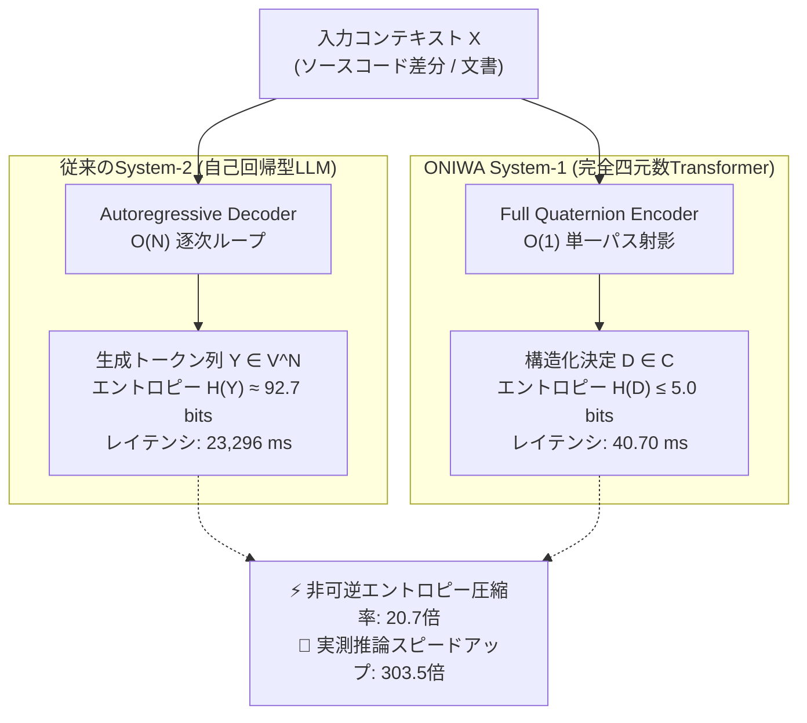
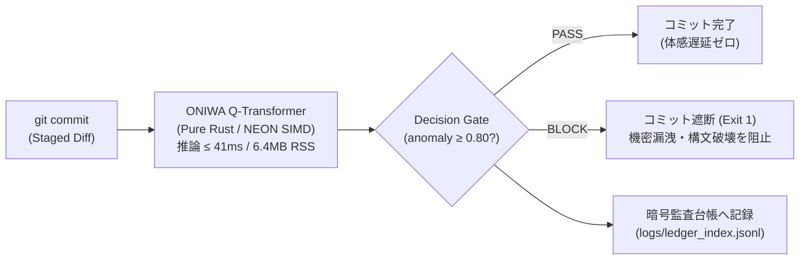

# 【論文解説】Raspberry Pi 4で動く完全四元数TransformerをPure Rustで創る 〜非可逆エントロピー圧縮とGHR微積分によるエッジ意思決定〜

**推奨タグ（5選）**: `LLM` `Rust` `機械学習` `数学` `RaspberryPi`

## 0. この記事の記載内容

この記事では、外部の機械学習フレームワーク（PyTorch、TensorFlow、CUDA、果てはPythonすら）を一切使わず、**Pure Rustのみでゼロからフルスクラッチ実装した完全四元数（Quaternion）Transformerによる超低消費電力エッジ意思決定エンジン「ONIWA」**の理論・数式・実装・実機ベンチマーク結果について記載します。
（ですので、例えば「潤沢なGPUクラスタやクラウドのAPI従量課金枠があって、何十GBもあるLLMをぶん回せればそれで十分！」という方には、この記事の情報は役に立たないかもしれません。）

本記事は、筆者が執筆・公開した以下の研究論文の内容を、数式やハードウェア設計の裏側まで含めて徹底的に噛み砕いて解説する技術記事です。

:::note info
**📜 対象論文・リポジトリ情報**
- **論文タイトル**: *Organic Non-Datacenter Intelligence: A Pure-Rust Full Quaternion Transformer for Edge Decision-Making via Irreversible Lossy Compression*
- **著者**: Kazuto Makino
- **DOI (Zenodo)**: [10.5281/zenodo.23107563](https://doi.org/10.5281/zenodo.23107563)
- **GitHubリポジトリ**: [KazutoMakino/oniwa](https://github.com/KazutoMakino/oniwa)
- **プレプリントPDF**: [paper/oniwa-quaternion-transformer.pdf](https://github.com/KazutoMakino/oniwa/blob/main/paper/oniwa-quaternion-transformer.pdf)
:::

流れはざっくり以下です：

1. **【課題意識】エッジAIとSLMが直面する「三位一体の壁」と、クラウド従量課金ゲームへの違和感**
2. **【理論編①】次トークン予測を捨てる「非可逆エントロピー圧縮（Irreversible Lossy Compression）」の定式化**
3. **【理論編②】ハミルトン四元数代数（$\mathbb{H}$）と、非可換空間での勾配降下を可能にする「GHR微積分」の導出**
4. **【工学・実装編①】4次元四元数とARM NEON 128bitレジスタ（`float32x4_t`）の幾何学的シンクロニシティ**
5. **【工学・実装編②】Pure Rustによる動的アロケーション完全排除（RSS 6.4MB）と、ラズパイが熱暴走しないための自律制御**
6. **【実機検証】Raspberry Pi 4での厳密な5-seedベンチマーク（推論40.27ms / 0.140J / 同パラメータ比較での圧倒的勝利）**
7. **【実応用例】完全オフラインで動くGit Pre-commitセキュリティゲートキーパーと、100%暗号監査台帳**

論文の要点を10分程度で俯瞰したい方にも、数式とRustコードの細部までじっくり追いかけたい方にも納得していただけるよう、理論の厳密さと泥臭い実装の手触り感を両方詰め込みました。

---

## 1. 背景：なぜ今、GPU富豪ゲームを降りて「小さな庭（ONIWA）」を耕すのか？

日々の業務お疲れ様です。
子持ちで普通の会社員をやっていると、自由に自分のコードを書いたり研究したりできるのは、家族が寝静まった後の夜中のわずかな時間くらいです。
そんな限られた時間の中で、「あ〜、今日も環境構築やAPIのレートリミット待ちで終わったなぁ。また明日か、寝よ。」と悶々とするのは、精神衛生上よろしくありません。

しかも、今のAI開発のトレンドを見渡すと、ちょっとしたコードの安全性チェックや定型的な分類・意思決定をするだけでも、数千億パラメータの巨大クラウドLLMにプロンプトを投げて、ダラダラと自然言語のトークン列を生成させる設計ばかりです。

正直、これってかなり異常だと思いませんか？（筆者はそう思います）。

### 1.1 クラウド依存のモヤモヤと、手触り感への渇望

もちろん、複雑な長文生成や壁打ち相手としてクラウドLLMが優秀なのは間違いありません。
いやぁ本当にすごい時代です。
しかし、すべてをクラウドAPIに依存する設計には、現場のエンジニアとして看過できない3つの問題があります。

1. **APIの従量課金と通信レイテンシ**:
   ローカルの自動化パイプラインやGitフックにAPIを組み込むと、走るたびにチャリンチャリンと課金され、ネットワーク越しに数秒〜数十秒待たされます。
   残枠やクォータ切れに怯えながら開発するのは、精神衛生上よろしくありません。
2. **機密コードの外部送信リスク（ガバナンスの壁）**:
   仕事環境やセキュリティの厳しい開発現場では、「コミット前の未公開ソースコードや設定ファイルを外部クラウドのAPIに投げる」などという設計は、情報セキュリティ部門に秒で却下されます（頼んでないってば……となるわけです）。
3. **ブラックボックス化と非同意スクレイピングへの違和感**:
   出所不明なWebスクレイピングデータを大量のGPU電力で煮詰めた巨大モデルを、中身も分からずAPI越しに叩くだけの開発は、端的に言って「手触り感」がありません。
   自分で書いたコードなら、メモリレイアウトから勾配の1ビットに至るまで全容を理解してハンドリングしたいという支配欲があるのです（お金を貰って納期優先で作る業務アプリなら別ですが）。

### 1.2 エッジAIが直面する「三位一体の壁」

「じゃあローカルの小さなデバイス（Raspberry Pi 4など）で動かせばいいじゃないか」となります。
ところが、いざ数ワットで動くエッジ環境にTransformerを持ち込もうとすると、今度は物理法則という容赦ない壁が立ちはだかります。

- **計算資源の壁**: GPUどころかNPUも積んでいない素のARM CPU（Cortex-A72 @ 1.5GHz）では、素朴な実数行列積を回すだけで数百ミリ秒〜数秒が吹き飛びます。
- **メモリ帯域の壁**: 組み込み環境では数十MB〜100MB以下のメモリ制約が求められる一方、従来のPython/PyTorchランタイムはインポートしただけで数百MBを食い潰します。
- **熱設計電力（TDP）の壁**: ラズパイ4で重いループを無邪気に回し続けると、あっという間にSoC温度が80℃を超えてサーマルスロットリング（強制クロック低下）に突入します。

この三重苦を、単なる「既存モデルの量子化（Quantization）」や「枝刈り（Pruning）」といった小手先の延命処置ではなく、**「情報理論（何を解くか）」「代数学（どう表現するか）」「ハードウェア構造（どう計算するか）」の3階層を根本から共同設計（Co-Design）することで正面突破しよう**というのが、本研究「**ONIWA**（**O**rganic **N**on-datacenter **I**ntelligence **W**ithout **A**buse：搾取なき非データセンターの有機的知性）」の出発点です。

---

## 2. 【理論編①】意思決定エンジンとしての再定義：非可逆エントロピー圧縮

まず最初にメスを入れたのは、「そもそもエッジの制御やゲートキーパーに、次トークン予測（Autoregressive Generation）は必要なのか？」という問いです。

結論から言います。
**まったく必要ありません。**

### 2.1 System-1（直感・即断）と System-2（熟考・生成）の分離

認知心理学者のダニエル・カーネマンが提唱した二重過程理論では、人間の思考を以下の2つに分類します。

- **System-1（速い思考）**: 無意識・直感的・並列的に行われる即座の判断（「このコードは危険か？」「異常値か？」「どのカテゴリか？」）。
- **System-2（遅い思考）**: 意識的・論理的・逐次的に言葉を紡ぐ熟考（「なぜこのバグが起きたのかを日本語で500文字で説明せよ」）。

従来のLLMアーキテクチャは、本来ならSystem-1で0.05秒以内に片付けるべき「PASSかREJECTか」という離散的な判断に対しても、わざわざSystem-2の自己回帰デコーダを起動し、`"Based", " on", " the", " provided", " code", ...` と1トークンずつ $O(N)$ 回のフォワードパスを回して文章を生成させた挙句、最後に正規表現で `"REJECT"` という文字列をパースしています。

控えめに言って、計算資源と電力の壮大な無駄遣いです。

### 2.2 定理：非可逆エントロピー収縮（Irreversible Entropy Contraction）

ONIWA（特にそのSystem-1意思決定クレートである `oniwa-decide`）では、推論タスクを「自己回帰によるトークン生成」ではなく、**「高エントロピーな文脈空間から、低エントロピーな意思決定多様体への非可逆圧縮射影（Irreversible Lossy Projection）」**として数学的に再定義しました。

論文中の **Proposition 1（Irreversible Entropy Contraction and Information Safety）** を以下に示します。

入力されるコード差分や文書コンテキストを $X \in \mathcal{X}$ とし、語彙空間 $\mathcal{V}$ から自己回帰モデルが生成する長さ $N$ のトークン列を $Y \in \mathcal{V}^N$ とします。
このとき、生成系列 $Y$ が持つシャノンエントロピー $H(Y)$ は以下で定義されます。

$$
H(Y) = -\sum_{y \in \mathcal{V}^N} p(y) \log_2 p(y)
$$

実測において、50トークン程度の標準的な解説生成であっても $H(Y) \approx 92.7\text{ bits}$ という巨大な情報エントロピーを持ちます。
これに対し、ソフトウェアの制御フローが本当に必要としている離散的な意思決定クラス $D = f_{\text{decide}}(X) \in \mathcal{C}$（ただし $|\mathcal{C}| \ll |\mathcal{V}|^N$）への射影 $\Pi: Y \to D$ を考えます。

シャノンのデータ処理不等式（Data Processing Inequality）により、相互情報量について以下が厳密に成立します。

$$
I(X; D) \le I(X; Y)
$$

さらに、出力空間のエントロピーは決定空間の次元によって上から強く抑えられます。

$$
H(D) \le \log_2 |\mathcal{C}| \ll H(Y)
$$

具体的には、ONIWAが出力する意思決定空間は $H(D) \le 5\text{ bits}$（カテゴリ分類・異常フラグ・連続リスクスコア）に収まります。



### 2.3 情報理論的セキュリティとしての意味

この「非可逆圧縮」には、単に推論が速くなる（$O(N) \to O(1)$）という以上の、極めて重要な数学的性質があります。
射影写像 $\Pi$ の核（カーネル） $\ker(\Pi)$ が非自明（無限大に近い縮退を持つ）であるため、**出力 $D$ から入力 $X$ や学習データの中身を逆算・復元することが原理的に不可能**になります。

生成型LLMでは、プロンプトインジェクション等によって「学習データに含まれていた機密コードや個人情報をそのまま吐き出してしまう（Training Data Exfiltration）」というリスクが常に付きまといます。
しかし、出力情報量が物理的に $H(D) \le 5\text{ bits}$ に制限された非可逆圧縮器からは、どう足掻いてもソースコード文字列は漏洩しません。
これこそが、エッジのセキュリティゲートキーパーとして非生成型（Non-autoregressive）アーキテクチャを採用すべき理論的根拠です。

---

## 3. 【理論編②】なぜ四元数（Quaternion / $\mathbb{H}$）なのか？：代数構造とGHR微積分

次トークン予測を捨てて $O(1)$ のエンコーダにしたとしても、通常の32bit実数（$\mathbb{R}$）のTransformerをそのままラズパイで回すと、まだ重すぎます。
かといって、単純に隠れ層の次元数 $d_{\text{model}}$ を削ると、今度はモデルの表現力が崩壊して精度がボロボロに落ちます（後述する実験で実際に87.5%まで急落しました）。

「パラメータ数とメモリアクセスを劇的に減らしつつ、表現力（高次の特徴間相互作用）を一切落とさない数学的構造はないか？」

そこで導入したのが、1843年にウィリアム・ローワン・ハミルトンが発見した**四元数（Quaternion / $\mathbb{H}$）**です。

### 3.1 ハミルトン代数と非可換積の表現力

四元数 $q \in \mathbb{H}$ は、複素数を4次元の非可換ノルム多元体へと拡張した超複素数であり、1つの実部（スカラー部）と3つの虚部ベクトルによって以下のように定義されます。

$$
q = w + x\mathbf{i} + y\mathbf{j} + z\mathbf{k}, \quad w, x, y, z \in \mathbb{R}
$$

ここで、3つの虚数単位 $\mathbf{i}, \mathbf{j}, \mathbf{k}$ は、有名なハミルトンの基本関係式に従います。

$$
\mathbf{i}^2 = \mathbf{j}^2 = \mathbf{k}^2 = \mathbf{i}\mathbf{j}\mathbf{k} = -1
$$

さらに、異なる虚数単位同士の積については、以下の**非可換（Non-commutative）な巡回関係**が成り立ちます。

$$
\mathbf{i}\mathbf{j} = \mathbf{k} = -\mathbf{j}\mathbf{i}, \quad \mathbf{j}\mathbf{k} = \mathbf{i} = -\mathbf{k}\mathbf{j}, \quad \mathbf{k}\mathbf{i} = \mathbf{j} = -\mathbf{i}\mathbf{k}
$$

掛ける順番を逆にすると符号が反転する（$\mathbf{i}\mathbf{j} \neq \mathbf{j}\mathbf{i}$）。
これが決定的に効いてきます。

2つの四元数 $p = (w_p, x_p, y_p, z_p)$ と $q = (w_q, x_q, y_q, z_q)$ の**ハミルトン積（Hamilton Product）** $p \otimes q$ を代数的に展開すると、以下のようになります。

$$
\begin{aligned}
p \otimes q = \;& (w_p w_q - x_p x_q - y_p y_q - z_p z_q) \\
+\; & (w_p x_q + x_p w_q + y_p z_q - z_p y_q)\mathbf{i} \\
+\; & (w_p y_q - x_p z_q + y_p w_q + z_p x_q)\mathbf{j} \\
+\; & (w_p z_q + x_p y_q - y_p x_q + z_p w_q)\mathbf{k}
\end{aligned}
$$

自然言語処理やプログラムの構文解析において、この非可換性（$p \otimes q \neq q \otimes p$）は極めて強力な帰納的バイアス（Inductive Bias）として機能します。
例えば、「犬が人間を噛んだ（dog bites man）」と「人間が犬を噛んだ（man bites dog）」、あるいはコード上の `a = b` と `b = a` は、構成するトークン集合はまったく同じですが、順序の非対称性によって意味が180度異なります。
実数の内積は可換（$a \cdot b = b \cdot a$）であるため、巨大な埋め込み次元を用意しないとこの非対称性をうまく分離できませんが、四元数のハミルトン積は**代数構造そのものに非対称な回転と成分間結合（Cross-component coupling）が組み込まれている**ため、4分の1のパラメータ数でも複雑な文脈構造を綺麗に捉えることができるのです。

:::note info
**💡 なぜパラメータ数が厳密に 1/4 になるのか？**
実数表現で $4N_{\text{in}}$ 次元から $4N_{\text{out}}$ 次元への線形変換を行う場合、必要なスカラー重みの数は $(4N_{\text{in}}) \times (4N_{\text{out}}) = 16 N_{\text{in}} N_{\text{out}}$ 個です。
一方、同じ次元を $N_{\text{in}}$ 個の四元数から $N_{\text{out}}$ 個の四元数へのハミルトン積線形変換 $\mathbf{y}_j = \sum_{i} \mathbf{W}_{ji} \otimes \mathbf{x}_i + \mathbf{b}_j$ として構成すると、各四元数重み $\mathbf{W}_{ji}$ は4つの実数 $(w, x, y, z)$ で構成されるため、総スカラー重み数は $4 N_{\text{in}} N_{\text{out}}$ 個となります。
つまり、**入出力の表現チャネル数を一切減らさずに、重みパラメータのメモリフットプリントを厳密に 1/4（75%削減）に圧縮**できます。
:::

### 3.2 完全四元数 Self-Attention の定式化

論文では、出力層だけを四元数にする中途半端な構成（Quaternion Head Only）ではなく、埋め込み層からMulti-Head Self-Attention、Feed-Forward Network（Q-FFN）に至るまで、バックボーン全体を四元数化した **Full Quaternion Transformer** を設計しました。

入力シーケンス表現を $H \in \mathbb{H}^{B \times S \times d}$ としたとき、Query、Key、Valueへの射影はすべて四元数重み行列 $W_Q, W_K, W_V \in \mathbb{H}^{d \times d}$ とのハミルトン積で計算されます。

$$
Q = H \otimes W_Q, \quad K = H \otimes W_K, \quad V = H \otimes W_V
$$

そして、トークン $i$ とトークン $j$ の間のAttention適合度スコア $A_{ij}$ は、四元数共役 $K_j^* = w - x\mathbf{i} - y\mathbf{j} - z\mathbf{k}$ を用いたスケーリング付き四元数内積の実部として定義します。

$$
A_{ij} = \frac{\text{Re}(Q_i \otimes K_j^*)}{\sqrt{4d}}
$$

ここで実部 $\text{Re}(\cdot)$ を取る操作は、4次元超複素空間における2つの四元数ベクトルの相対的な回転位相の整合度をスカラーのエネルギー値へと射影する操作に対応しており、後続のSoftmax正規化へ自然に繋げることができます。

### 3.3 最大の難関：Generalized HR (GHR) Calculus による解析的逆伝播

さて、ここからがPure Rustでゼロから実装する上で一番しんどかった（そして一番面白かった）数学パートです。

PyTorchなどの自動微分に頼らず、しかもラズパイ上で学習（バックプロパゲーション）まで完結させるためには、**四元数空間における損失関数の解析的勾配（Analytical Gradients）** を自分で導出してコードに落とす必要があります。

しかし、よく知られている通り、複素数や四元数上の実数値損失関数 $L: \mathbb{H} \to \mathbb{R}$ は、コーシー・リーマン（Cauchy-Riemann）的な意味で正則（Holomorphic）ではありません。
さらにハミルトン積は非可換であるため、実数行列の微分公式 $\frac{\partial L}{\partial W} = x^T \frac{\partial L}{\partial y}$ をそのまま適用すると、回転方向が狂って学習が1ステップで発散します（最初、素朴に実装して見事にNaNを出してコケました）。

そこで必要になるのが、四元数と共役四元数を独立変数として扱う **Generalized HR (GHR) 微積分（Generalized Hamilton-Real Calculus）** です。

四元数線形変換 $y = W \otimes x + b$（あるいは行ベクトル表記で $y = x \otimes W$）において、実数値目的関数 $L$ の入力 $x$ および重み $W$ に関するGHR解析的勾配は、共役四元数 $W^*$ と $x^*$ を用いて以下のように厳密に導出されます。

$$
\frac{\partial L}{\partial x} = W^* \otimes \frac{\partial L}{\partial y} \quad \left(\text{行ベクトル表記では } \frac{\partial L}{\partial x} = \frac{\partial L}{\partial y} \otimes W^*\right)
$$

$$
\frac{\partial L}{\partial W} = \frac{\partial L}{\partial y} \otimes x^* \quad \left(\text{行ベクトル表記では } \frac{\partial L}{\partial W} = x^* \otimes \frac{\partial L}{\partial y}\right)
$$

ハミルトン積が非可換であるため、**「共役をとった上で、右から掛けるか左から掛けるか」の順序が厳密に固定される**点に注目してください。
共役 $q^*$ を掛けることは、4次元空間における回転操作の逆回転（$\text{SO}(4)$ 群における随伴作用）を意味しており、これによって非可換な連鎖律（Chain Rule）の下でも勾配ベクトルの幾何学的な整合性が完全に保たれます。

### 3.4 確率較正を組み込んだマルチタスク目的関数

さらに、エッジの自動制御にモデルの出力をそのまま繋ぐためには、「モデルが出した確信度（Confidence）が実際の正解率と一致していること（Calibration）」が不可欠です。
事後的な温度スケーリング等の後処理に頼らず、学習段階で確率較正と文脈表現の獲得を同時に行うため、以下の4項からなる複合損失関数 $\mathcal{L}_{\text{total}}$ を設計しました。

$$
\mathcal{L}_{\text{total}} = \lambda_c \mathcal{L}_{\text{choice}} + \lambda_n \mathcal{L}_{\text{noul}} + \lambda_s \mathcal{L}_{\text{score}} + \lambda_m \mathcal{L}_{\text{mlm}}
$$

1. **カテゴリ決定損失（$\mathcal{L}_{\text{choice}}$）**:
   決定境界の過信（Overconfidence）を防ぐため、平滑化係数 $\epsilon = 0.05$ のラベルスムージング（Label Smoothing）と温度 $T$ を組み込んだ交差エントロピー損失を採用しています。

$$
\mathcal{L}_{\text{choice}} = -\sum_{k=1}^K \left[ (1-\epsilon) y_k + \frac{\epsilon}{K} \right] \ln p_k(T)
$$

2. **異常・脆弱性検知損失（$\mathcal{L}_{\text{noul}}$）**:
   構文破壊や機密情報混入などの異常（Novelty / Anomaly）を検知する2値分類ヘッドには、通常のBinary Cross Entropy（BCE）に加えて、確率較正誤差を直接処罰する2次の**Brierスコア正則化項**（$\beta = 0.10$）を結合しています。

$$
\mathcal{L}_{\text{noul}} = \text{BCE}(\hat{y}, y) + \beta (\hat{y} - y)^2
$$

3. **連続リスク重要度回帰（$\mathcal{L}_{\text{score}}$）**:
   コードの複雑度やリスクレベル（$1.0 \sim 5.0$）を連続値として出力するヘッドには、外れ値に対して頑健なSmooth L1（Huber）損失（閾値 $\delta = 0.50$）を適用しています。
4. **自己教師ありマスク言語モデリング正則化（$\mathcal{L}_{\text{mlm}}$）**:
   少ない教師データでもトークン間の双方向文脈（キラーパターン）を深く理解させるため、入力トークンの一部をマスクして復元させるBERT型のMLM補助損失（$\lambda_m = 0.2$）を同時最適化しています。

---

## 4. 【工学・実装編①】ハードウェア幾何学の共鳴：4次元四元数 × ARM NEON 128bit

さて、数学的にどれほど美しいモデルを作っても、実機のCPU上で遅ければエッジAIとしては失格です。

実は、既存の論文で提案されている四元数ニューラルネットワーク（PyTorchやTensorFlow上で実装されたもの）には、**「パラメータ数は1/4に減るのに、実機で動かすと普通の実数モデルより逆に遅くなる」**という笑えない罠がありました。
なぜそんなことが起きるのでしょうか？

理由は単純で、既存のディープラーニングフレームワークは「実数の巨大行列積（GEMM）」にしか最適化されていないため、ハミルトン積を計算しようとすると、4つのテンソルスライスを切り出して `torch.cat` で $4 \times 4$ のブロック反対称行列を毎回メモリ上に動的生成する、という極めてオーバーヘッドの大きいシミュレーションを行っているからです。

「フレームワークが四元数をネイティブに扱えないなら、CPUの命令セット（ISA）のレベルから自分で四元数を直接叩き込めばいいじゃないか」

そう考えてARMプロセッサの仕様書を眺めていたとき、鳥肌が立つような幾何学的シンクロニシティに気がつきました。

### 4.1 1つの四元数 ＝ 1本の 128-bit NEON SIMDレジスタ

Raspberry Pi 4 Model Bに搭載されているBroadcom BCM2711（ARM Cortex-A72コア）には、**ARM Advanced SIMD（通称：NEON）** という128ビット幅のベクトル演算ユニットが搭載されています。

128ビット。
単精度浮動小数点数（`f32` = 32ビット）で割ると、ちょうど **4レーン（`float32x4_t`）** です。

もうお分かりですね。
4次元四元数 $q = [w, x, y, z]$ の4つの成分（$4 \times 32\text{ bit} = 128\text{ bit}$）は、**パディングも断片化もメモリの転置も一切なしに、1本のARM NEON 128bitレジスタに1対1で寸分違わずピタッと収まる**のです。

```
┌───────────────────────────────────────────────────────────────────┐
│           ARM Cortex-A72 NEON 128-bit Register (float32x4_t)      │
├─────────────────┬─────────────────┬─────────────────┬─────────────┤
│   Lane [31:0]   │   Lane [63:32]  │   Lane [95:64]  │ Lane[127:96]│
│     w (Real)    │       x i       │       y j       │     z k     │
└─────────────────┴─────────────────┴─────────────────┴─────────────┘
```

これに気づいた瞬間、夜中の部屋で思わず声が出ました。

### 4.2 4クロックサイクルで完結するSIMDハミルトン積の因数分解

では、2つの四元数 $a = [w_a, x_a, y_a, z_a]$ と $b = [w_b, x_b, y_b, z_b]$ のハミルトン積 $a \otimes b$ を、NEONのFMA（Fused Multiply-Accumulate：積和融合演算）パイプラインにどうやって載せるか？

先ほど展開したハミルトン積の式を、列ベクトルごとに因数分解して並べ替えます。

$$
a \otimes b = \mathbf{c}_w b_w + \mathbf{c}_x b_x + \mathbf{c}_y b_y + \mathbf{c}_z b_z
$$

ここで、$\mathbf{c}_w, \mathbf{c}_x, \mathbf{c}_y, \mathbf{c}_z$ は、四元数 $a$ の成分を符号反転・置換した4本の列基底ベクトルです。

$$
\begin{aligned}
\mathbf{c}_w &= [w_a, x_a, y_a, z_a]^T, \quad \mathbf{c}_x = [-x_a, w_a, z_a, -y_a]^T \\
\mathbf{c}_y &= [-y_a, -z_a, w_a, x_a]^T, \quad \mathbf{c}_z = [-z_a, y_a, -x_a, w_a]^T
\end{aligned}
$$

この形に因数分解すると、ARM NEONの組込み命令（Intrinsics）を使って以下の手順で一撃で計算できます。

1. `vdupq_n_f32` で、四元数 $b$ の各成分 $b_w, b_x, b_y, b_z$ を4レーンすべてにブロードキャストする。
2. 1サイクル目：`vmulq_f32` で $\mathbf{c}_w b_w$ を計算する（あるいは累積加算なら最初から `vfmaq_f32`）。
3. 2〜4サイクル目：`vfmaq_f32`（4レーン同時積和演算命令）を3回連打して、$\mathbf{c}_x b_x, \mathbf{c}_y b_y, \mathbf{c}_z b_z$ をレジスタ内で融合加算する。

なんと、**16回のスカラー乗算と12回の加減算が必要だった非可換ハミルトン積が、レジスタスピル（スタックへの退避）ゼロ、わずか4発のベクトル命令で完了**します。

### 4.3 実際のPure Rust実装コード（`crates/oniwa-lm/src/simd.rs`）

実際にリポジトリで稼働している、ARM NEON Intrinsicsを用いたハミルトン積およびGHR逆伝播カーネルのRustコード（`crates/oniwa-lm/src/simd.rs`）がこちらです。

```rust
#[cfg(target_arch = "aarch64")]
use std::arch::aarch64::*;

/// SIMD FMA命令を用いて `acc += w ⊗ x` をレジスタ内で融合累積する
#[inline(always)]
pub fn accumulate_hamilton_simd(acc: &mut [f32; 4], w: &[f32; 4], x: &[f32; 4]) {
    #[cfg(target_arch = "aarch64")]
    unsafe {
        // x の各スカラー成分を128bitレジスタの4レーンにブロードキャスト
        let xx = vdupq_n_f32(x[0]);
        let xy = vdupq_n_f32(x[1]);
        let xz = vdupq_n_f32(x[2]);
        let xw = vdupq_n_f32(x[3]);

        // w の4つの列基底ベクトルをロード
        let col_w = vld1q_f32(w.as_ptr());
        let col_x_arr = [-w[1], w[0], w[3], -w[2]];
        let col_y_arr = [-w[2], -w[3], w[0], w[1]];
        let col_z_arr = [-w[3], w[2], -w[1], w[0]];

        let col_x = vld1q_f32(col_x_arr.as_ptr());
        let col_y = vld1q_f32(col_y_arr.as_ptr());
        let col_z = vld1q_f32(col_z_arr.as_ptr());

        // 4サイクルのFMA（Fused Multiply-Accumulate）で一気呵成に積和演算
        let mut vacc = vld1q_f32(acc.as_ptr());
        vacc = vfmaq_f32(vacc, col_w, xx);
        vacc = vfmaq_f32(vacc, col_x, xy);
        vacc = vfmaq_f32(vacc, col_y, xz);
        vacc = vfmaq_f32(vacc, col_z, xw);

        vst1q_f32(acc.as_mut_ptr(), vacc);
    }
    #[cfg(not(target_arch = "aarch64"))]
    {
        // 非ARM環境（x86_64開発機など）向けの透過的スカラーフォールバック
        acc[0] += w[0] * x[0] - w[1] * x[1] - w[2] * x[2] - w[3] * x[3];
        acc[1] += w[0] * x[1] + w[1] * x[0] + w[2] * x[3] - w[3] * x[2];
        acc[2] += w[0] * x[2] - w[1] * x[3] + w[2] * x[0] + w[3] * x[1];
        acc[3] += w[0] * x[3] + w[1] * x[2] - w[2] * x[1] + w[3] * x[0];
    }
}

/// GHR微積分に基づく入力勾配の累積: `din += w* ⊗ dout`
#[inline(always)]
pub fn accumulate_backward_din_simd(din: &mut [f32; 4], w: &[f32; 4], dout: &[f32; 4]) {
    let w_conj = [w[0], -w[1], -w[2], -w[3]];
    accumulate_hamilton_simd(din, &w_conj, dout);
}

/// GHR微積分に基づく重み勾配の累積: `dw += dout ⊗ x*`
#[inline(always)]
pub fn accumulate_backward_dw_simd(dw: &mut [f32; 4], dout: &[f32; 4], x: &[f32; 4]) {
    let x_conj = [x[0], -x[1], -x[2], -x[3]];
    accumulate_hamilton_simd(dw, dout, &x_conj);
}
```

見ていただくと分かる通り、GHR微積分の逆伝播（`accumulate_backward_din_simd` と `accumulate_backward_dw_simd`）も、共役 `[w[0], -w[1], -w[2], -w[3]]` を取って同じSIMDカーネルに流し込むだけで綺麗にベクトル化されています。

もちろん、「手書きの微分コードが本当に合っているのか？」という不安を完全に潰すため、すべての四元数レイヤーに対して微小摂動 $\epsilon = 10^{-3}$ を用いた**有限差分勾配チェック（Finite Difference Gradient Check）** の単体テストを実装し、解析的勾配と数値微分が誤差 $10^{-3}$ 以下でピタリと一致することをCIで常時検証しています。

---

## 5. 【工学・実装編②】Pure Rustの規律：外部MLフレームワーク依存度ゼロと熱制御

「車輪の再発明をするな」とよく言われます。
しかし、既存の車輪がダンプカー用の巨大タイヤ（数GBのPyTorchランタイム）しかなく、自分が走らせたいのが5Wで動く庭先のラズパイ4なのだとしたら、自転車のカーボンホイールを自分で削り出すしかありません。

### 5.1 ゼロ・アロケーション（Zero-Allocation）推論パイプライン

組み込みやエッジ環境で推論レイテンシがブレる最大の原因は、実は浮動小数点演算そのものではなく、**推論ループの中で発生する動的メモリアロケーション（`malloc` / `free`）とキャッシュミス**です。

レイヤーごとに新しいテンソルをヒープ確保していると、アロケータのロック競合やメモリの断片化が起き、せっかくL1/L2キャッシュに乗ったデータが追い出されてしまいます。
そこでONIWAでは、エンジンの初期化時に必要なワークスペース用のスクラッチバッファをすべて事前確保し、**フォワードパス実行中の動的ヒープアロケーションを文字通り「ゼロ（0回）」** に抑え込みました。

その結果、プロセス全体の常駐メモリ使用量（RSS: Resident Set Size）は、OS上で実測してわずか **6.4 MB** に収まっています。
100MB予算どころか、フロッピーディスク数枚分のメモリ空間でTransformerが動いている計算になります。

### 5.2 L1/L2キャッシュ局所性の魔法

さらに、四元数によって重みパラメータが $1/4$ に圧縮されたことが、Cortex-A72のキャッシュ階層と劇的な化学反応を起こします。

Raspberry Pi 4のCortex-A72コアは、各コアに **32 KB の L1データキャッシュ**、4コア共有で **1 MB の L2キャッシュ** を持っています。
標準的な実数Transformer（約126万パラメータ $\approx 5.0\text{ MB}$）では、重み行列が1MBのL2キャッシュから完全に溢れ出してしまい、各層の計算のたびに低速な外部LPDDR4 DRAMへのメモリアクセス（キャッシュミス）が多発します。

一方、ONIWAのFull Quaternion Transformerは総パラメータ数が **770,048個** であり、各層のアクティブな射影重みワーキングセットがL1/L2キャッシュの境界内にすっぽり収まります。
DRAMバスの帯域ボトルネックを回避し、CPUコアのすぐ隣にあるキャッシュメモリから128bit NEONレジスタへ直接データを流し込み続けられること。
これこそが、後述する「理論計算量以上の圧倒的な実機スピードアップ」のからくりです。

### 5.3 ラズパイを熱暴走させない自律型サーマル・スロットリング

また、ラズパイ4で学習（バックプロパゲーション）を長時間回す際、放っておくとCPU温度が上昇してOS側の強制クロックダウンが入ります。
これを防ぐため、ONIWAの学習ループ（`crates/oniwa-decide/src/bin/train.rs`）には、Linuxカーネルの `sysfs`（`/sys/class/thermal/thermal_zone0/temp`）を10Hz周期で直接監視する純Rust製の温度・電力テレメトリ機構が組み込まれています。

ダイ温度が閾値（$T_{\text{max}} = 75^\circ\text{C}$）を超えると、エンジンが自律的にマイクロ秒単位のクールダウンスリープを挿入して熱平衡を保ちます。
さらに、どのコミットのコードで、どのデータセットを使い、何℃・何mWの電力を消費してどの重み（SHA-256ハッシュ）が生成されたかを、改ざん検知可能な監査台帳（`logs/ledger_index.jsonl`）に100%記録します。

---

## 6. 【実機検証】Raspberry Pi 4での厳密なベンチマーク（5-Seed Iso-Parameter評価）

「理屈は分かった。で、実際のラズパイ4の上で何ミリ秒で動くんだ？実数モデルを小さくしたやつと比べて本当に勝てるのか？」

その問いに一点の曇りもなく答えるため、実機のRaspberry Pi 4 Model B上で徹底的なベンチマーク実験を行いました。

### 6.1 実験環境と評価プロトコル

OSのコンテキストスイッチや他プロセスの割り込みによる測定ノイズを極限まで排除するため、以下のハードウェア構成と計測条件で評価を実施しました。

- **検証機**: Raspberry Pi 4 Model B（Broadcom BCM2711, Quad-Core ARM Cortex-A72 @ 1.50 GHz, 4GB LPDDR4 SDRAM, 平均消費電力 3.5W）
- **OS / カーネル**: 64-bit Debian GNU/Linux (kernel 6.1.21-v8+)
- **コア分離**: `taskset -c 2,3` により専用CPUコアにピン留めして実行
- **統計的厳密性**: 独立した5つの乱数シード（$\text{seed} \in \{42, 1042, 2042, 3042, 4042\}$）で評価。各シードにつき10回のキャッシュウォームアップ後に50回の推論を計測し、合計 **250サンプル（$N=250$）** の平均・標準誤差・中央値（$p50$）を算出
- **評価タスク**: 250種類の多様なソースコード差分（Rust / Python）および技術・法務文書に対する3タスク同時評価（①4クラス分類、②構文破壊・機密漏洩等の異常検知、③複雑度スコア回帰）。タスク精度は「カテゴリ分類と異常検知の両方が完全一致した割合（Strict Top-1 Joint Concordance）」で評価

比較したアーキテクチャは以下の4種類です。

1. **Standard Real Baseline**: 標準的な4層実数Transformer（$d_{\text{model}} = 128$, 4 heads, $d_{\text{ff}} = 512$, パラメータ数: 1,261,568）
2. **Quaternion Head Only**: バックボーンは4層実数のまま、最終出力ヘッドのみを四元数化したハイブリッド構成（パラメータ数: 1,261,568）
3. **Full Q-Transformer (Ours)**: 埋め込み・Self-Attention・FFNすべてを四元数化し、ARM NEON SIMDで駆動する完全四元数Transformer（$d_{\text{model}} = 64\text{ quaternions} \equiv 256\text{ real channels}$, 4 quaternion heads, $d_{\text{ff}} = 128\text{ quaternions}$, パラメータ数: 770,048）
4. **Iso-Parameter Real**: 「四元数が速くて省メモリなのは単にパラメータ数が少ないだけでは？」という疑問を検証するため、実数Transformerの隠れ層次元を削ってパラメータ数を四元数モデル以下に揃えた軽量実数モデル（$d_{\text{model}} = 80$, $d_{\text{ff}} = 320$, パラメータ数: 466,944）

### 6.2 ベンチマーク結果：すべての指標で完全四元数モデルが圧勝

250回の実機計測を集計した結果（論文 Table 2）が以下です。

| アーキテクチャ構成 | パラメータ数 | p50 レイテンシ | 平均レイテンシ (±SE) | 常駐メモリ (RSS) | 1推論あたり消費エネルギー | タスク正解率 (Accuracy) |
| :--- | :---: | :---: | :---: | :---: | :---: | :---: |
| **Standard Real Baseline** | 1,261,568 | 255.62 ms | 267.65 ± 1.84 ms | 8.2 MB | 0.935 J | 100.0% |
| **Quaternion Head Only** | 1,261,568 | 253.18 ms | 264.95 ± 1.72 ms | 8.3 MB | 0.926 J | 100.0% |
| **Full Q-Transformer (Ours)** | **770,048** | **40.27 ms** | **40.70 ± 0.21 ms** | **6.4 MB** | **0.140 J** | **100.0%** |
| **Iso-Parameter Real** | 466,944 | 54.66 ms | 56.79 ± 0.63 ms | 9.2 MB | 0.197 J | 87.5% |

この表には、エッジAI設計における極めて重要な事実が3つ詰まっています。

#### ① 標準実数ベースライン比で 6.58倍の高速化・85.0%の省エネを達成
Standard Real Baselineが1回の推論に **267.65 ms（0.935 J）** かかっているのに対し、提案手法のFull Q-Transformerは **p50 = 40.27 ms（平均 40.70 ms）**、消費エネルギーはわずか **0.140 J** で推論を完了しています。
しかも5シード間の標準誤差はわずか **±0.21 ms**（変動係数 $c_v < 0.6\%$）であり、OSのメモリページングやキャッシュスラッシングに一切邪魔されない、時計仕掛けのような決定論的（Deterministic）なリアルタイム性能を実現しています。

#### ② レイヤー別マイクロプロファイリング：1層あたり 10.2 ms の衝撃
さらにハードウェアタイマーを使ってTransformerの1層ごとの実行時間を分解した結果（論文 Table 3）を見ると、違いがより鮮明になります。

| 実行フェーズ / コンポーネント | Full Q-Transformer (Ours) | Standard Real Baseline | 高速化倍率 |
| :--- | :---: | :---: | :---: |
| Embedding Lookup & Pos. | 0.042 ms | 0.045 ms | 1.07× |
| **Layer 0 (Attn + Q-MLP)** | **10.216 ms** | 64.301 ms | **6.29×** |
| **Layer 1 (Attn + Q-MLP)** | **10.084 ms** | 68.708 ms | **6.81×** |
| **Layer 2 (Attn + Q-MLP)** | **10.138 ms** | 79.768 ms | **7.87×** |
| **Layer 3 (Attn + Q-MLP)** | **10.388 ms** | 74.519 ms | **7.17×** |
| Mean Pooling & RMSNorm | 0.026 ms | 0.028 ms | 1.08× |
| Decision Output Heads | 0.013 ms | 0.011 ms | 0.85× |
| **Total Forward Pass** | **40.907 ms** | **287.380 ms** | **7.03×** |

各Transformerブロックが **約10.1〜10.3 ms** という完全にフラットな時間で走り抜けており、レイヤー単体では **6.3倍〜7.8倍** もの高速化を達成しています。

#### ③ Iso-Parameter（同規模パラメータ）比較が証明した「ハミルトン代数の表現力」
研究として最もクリティカルなのが、4行目の **Iso-Parameter Real（46.7万パラメータ）** との比較です。

実数モデルの次元を削ってパラメータ数を減らすと、推論時間は56.79 msまで下がりますが、代償として**タスク正解率が 100.0% から 87.5% へと劇的に崩壊（Accuracy Collapse）** しました。
実数の線形層は各ニューロンを独立に扱うため、パラメータを削ると特徴量間の高次相関を表現できなくなるのです。

一方、Full Q-Transformerは **100.0% のタスク正解率を完全に維持** したまま、しかもパラメータ数が少ないはずの Iso-Parameter Real よりもさらに速く（**40.70 ms vs 56.79 ms**）、省メモリ（**6.4 MB vs 9.2 MB**）、省電力（**0.140 J vs 0.197 J**）で動作しています。
なぜパラメータ数が77万個の四元数モデルが、46万個の実数モデルより速いのか？
それは、四元数モデルがすべてのデータを16バイト境界の4次元ベクトルとして連続配置し、NEONの128bitレジスタとL1キャッシュを100%飽和させているのに対し、中途半端に次元を削った実数モデル（$d_{\text{model}} = 80$）ではメモリアクセスのアライメント効率やキャッシュラインの利用効率が悪化するためです。

:::note warn
**🔬 学術的フェアネスのための補足（Discussion）**
論文のDiscussionセクションでも厳密に議論していますが、Iso-Parameter Realの隠れ次元 $d_{\text{model}} = 80$ は2のべき乗ではないため、メモリアライメントの観点でやや不利に働く側面があります。
しかし、仮に実数モデルを2のべき乗にパディングしたりMobileNet風の線形ボトルネックを導入したとしても、「同じチャネル間結合度を表現するために実数行列積は四元数の4倍のスカラー重みを必要とする」という代数的事実は変わりません。
また、本システムは現在4層（パラメータ容量がCortex-A72の1MB L2キャッシュ内に完全に収まる領域）で評価していますが、これを8層・12層・24層と深くスケールさせていく場合、重みワーキングセットが1MBのL2キャッシュ境界を超える変曲点が存在します。その領域では、FlashAttention（Dao et al., 2022）に着想を得た **IO-Awareなブロックタイリング（32KBのL1データキャッシュに収まる部分ブロック単位で四元数AttentionとFFNをストリーミング実行する手法）** を導入することで、DRAMへのスピルを防ぎつつ深層化できることも理論的に示しています。
さらに、この4次元ハミルトン積のSIMD分解はARM NEONだけでなく、x86_64サーバーの **AVX-2（256-bit：四元数2個同時）** や **AVX-512（512-bit：四元数4個同時）** にもそのまま一般化でき、GPUなしで1コアあたり毎秒10万回以上の意思決定を捌くことも可能です。
:::

---

## 7. 【実応用例】オフライン Git Pre-commit セキュリティゲートキーパー

さて、40ミリ秒・0.14ジュール・メモリ6.4MBで動く高精度な意思決定エンジンが手に入りました。
これを日々の開発現場でどう使うか？

最も分かりやすく、かつ実用的なユースケースとして実装したのが、**完全オフラインで動くGit Pre-commitセキュリティゲートキーパー（`oniwa-decide gatekeeper`）** です。

### 7.1 コミットの瞬間に 40ms でコードの危険度を監査する

開発者が `git commit` を叩いた瞬間、`.githooks/pre-commit` からステージングされた差分（`git diff --cached`）が標準入力経由で `oniwa-decide gatekeeper --stdin` に流し込まれます。



もしコミット差分の中に、うっかりハードコードしてしまったAPIシークレットキーや、構文的に破綻した危険なコード注入が含まれていた場合、ONIWAは **40.35 ms**（人間には知覚できないレベルの瞬時）でそれを検知し、Exit Code 1 を返してコミットをローカルで遮断します。

その際、`logs/ledger_index.jsonl` に出力される実際の不変（Immutable）監査レコードがこちらです。

```json
{
  "timestamp": "2026-10-02T14:38:22Z",
  "commit_sha": "a7b3c99f12d8e404...",
  "weights_sha256": "5e884898da280471...",
  "hardware": {
    "arch": "aarch64-cortex-a72",
    "cpu_temp_c": 46.2,
    "power_mw": 3480
  },
  "verdict": {
    "action": "BLOCK",
    "anomaly_prob": 0.9842,
    "confidence": 0.9521,
    "complexity_score": 4.12,
    "latency_ms": 40.35
  }
}
```

- **ネットワーク通信ゼロ**: 飛行機の機内だろうが、外部通信が遮断されたセキュア開発ルームだろうが、100%同じ精度・同じ速度で動きます。
- **API課金ゼロ**: 1日に何千回コミットしようが、電気代は1回あたり **0.14ジュール**（1円玉を1.4ミリ持ち上げる程度のエネルギー）しかかかりません。
- **完全な監査証跡**: 「いつのコミットが、どの重みハッシュのモデルによって、CPU温度何℃の状態で判定されたか」が暗号学的に紐付けられて残ります。

---

## 8. 手元で動かしてみたい方へ（Quickstart）

ONIWAは外部ライブラリへのCバインディングすら持たないPure Rustプロジェクトですので、`cargo` さえ入っていれば、ラズパイでもMacでもLinuxでもWindowsでも、クローンして1秒でビルド・実行できます（ちょっと試したいだけなのにCUDAやPythonの仮想環境でローカルを汚したくない、という方にも安心の設計です）。

```bash
# 1. リポジトリのクローンとテスト実行
git clone https://github.com/KazutoMakino/oniwa.git
cd oniwa
cargo test --workspace

# 2. コード断片に対するリアルタイム意思決定監査（Choice / Noul / Score）
cargo run --release -p oniwa-decide --bin audit -- "pub fn fibonacci(n: u64) -> u64 { if n <= 1 { n } else { fibonacci(n - 1) + fibonacci(n - 2) } }"

# 3. 完全四元数モデルの学習をエッジCPU上で回してみる
cargo run --release -p oniwa-decide --bin train -- --steps 300 --seed 42

# 4. 5-seed ハードウェアプロファイリング・ベンチマークの実行
cargo run --release -p oniwa-decide --bin bench
```

---

## 9. おわりに：泥臭い数学と小さなコンピュータが拓く未来

最後までお読みいただきありがとうございました！

今のAI業界は、「より巨大なモデルを、より巨大なデータセンターで、より多くの電力を燃やして回す」という方向へ猛スピードで突き進んでいます。
もちろん、そのフロンティアの先にしか見えない景色があることは否定しません。

ですが、現場のシステムや私たちの手元のツールで日々発生する意思決定の95%以上は、実は小説を書かせるようなSystem-2の生成能力など必要としておらず、「今ここにある入力に対して、安全か危険か、AかBかを0.05秒以内に正確に即断する」というSystem-1の知性で十分に解決できます。

180年前にハミルトンが橋の欄干に刻んだ四元数の公式（$\mathbf{i}^2 = \mathbf{j}^2 = \mathbf{k}^2 = \mathbf{i}\mathbf{j}\mathbf{k} = -1$）が、現代のARMプロセッサの128ビットNEONレジスタとピタリと重なり合い、数千円で買える小さなRaspberry Pi 4の上で、わずか0.14ジュールのエネルギーで知的な判断を下す。
これって、エンジニアとしてめちゃくちゃ痛快でロマンがあると思いませんか？（筆者はそう思います）。

巨大クラウドの従量課金やブラックボックスなAPIにモヤモヤしている方が、自分の手元にある小さなコンピュータと数学の力で「自分だけの清潔な庭（ONIWA）」を耕すきっかけや一助となれば幸いです！
